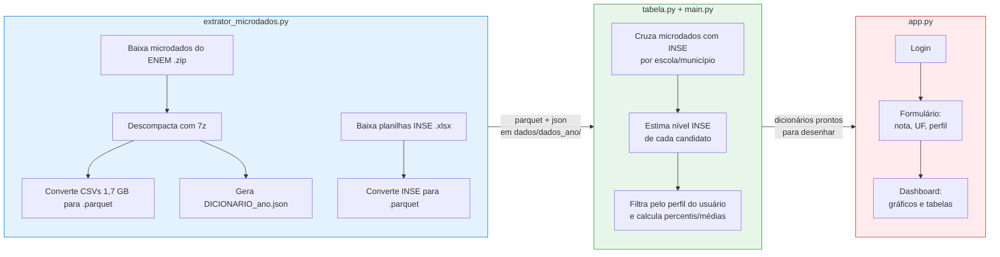
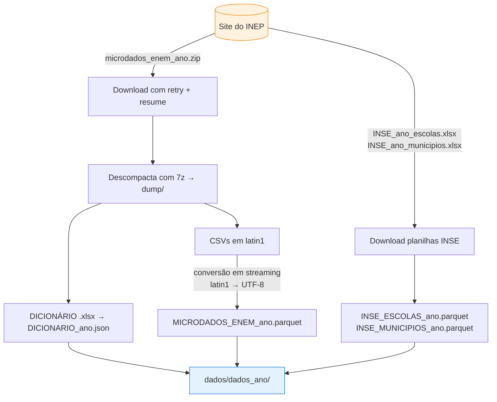
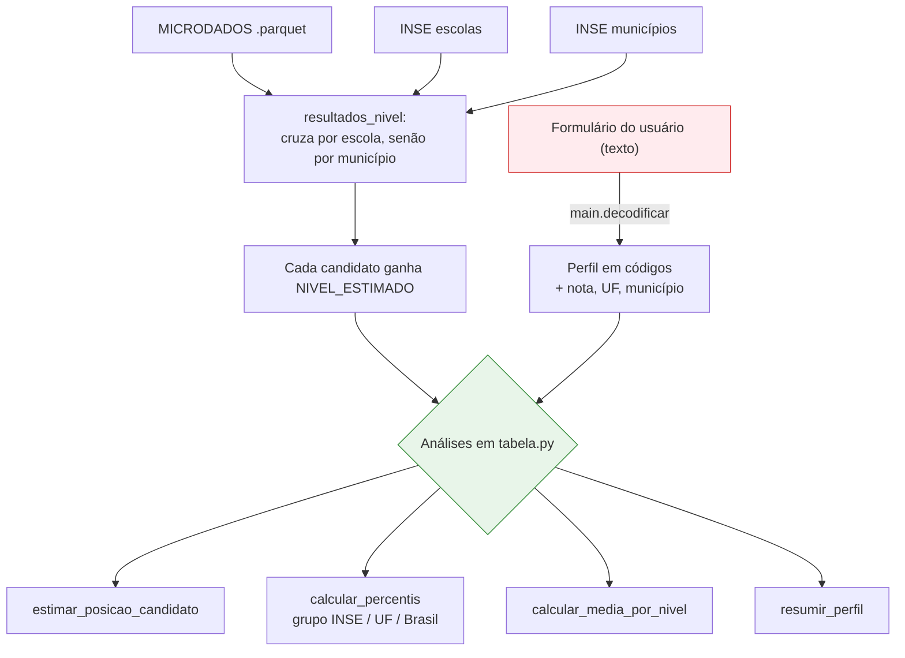
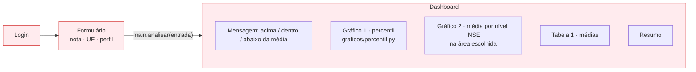

# Pipeline do projeto

Visão geral do fluxo, do download dos dados brutos do INEP até o dashboard no app.
Os diagramas são em [Mermaid](https://mermaid.js.org/) e renderizam direto no GitHub.

## Visão geral (as três etapas)

## Detalhe por camada

### 1. Extração (`extrator_microdados.py`)

Transforma os dados brutos do INEP em arquivos prontos para o app. Roda uma vez por ano.

> ⚠️ Só **2019, 2021 e 2023** têm INSE publicado, então só esses anos podem ser cruzados.

### 2. Tratamento (`tabela.py`) + orquestração (`main.py`)

`main.py` carrega os dados uma vez, decodifica o que vem do formulário (texto → código do INEP)
e chama o `tabela.py`, que só faz cálculo (sem Streamlit).

> Grupos com menos de `MIN_CANDIDATOS` (30) não são calculados, para o resultado não ficar instável.

### 3. App (`app.py` + `graficos/`)

Três páginas em Streamlit. O app não lê dados nem conhece códigos do INEP — só desenha o que o `main.py` devolve.

## Arquivos gerados por ano

Em `dados/dados_{ano}/`:

| Arquivo | Conteúdo |
|---|---|
| `MICRODADOS_ENEM_{ano}.parquet` | Microdados do ENEM (notas + perfil) |
| `INSE_ESCOLAS_{ano}.parquet` | Nível socioeconômico por escola |
| `INSE_MUNICIPIOS_{ano}.parquet` | Nível socioeconômico por município |
| `DICIONARIO_{ano}.json` | `{variável: {código: descrição}}` do questionário |
